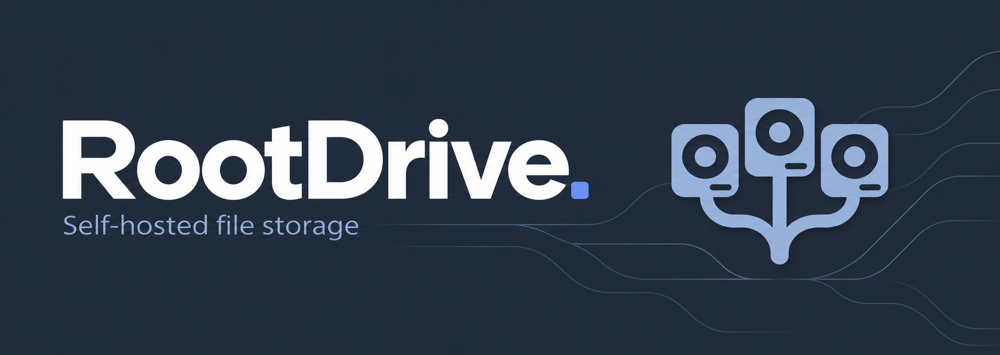
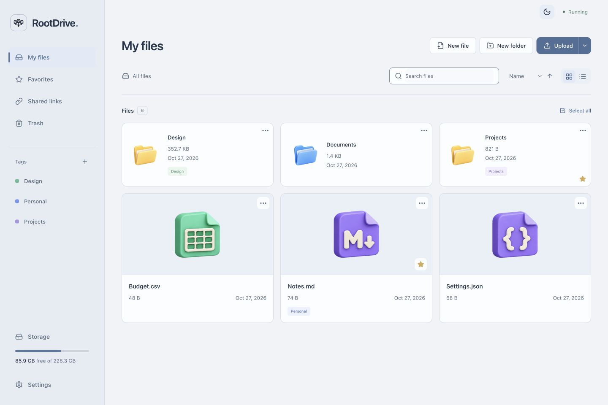
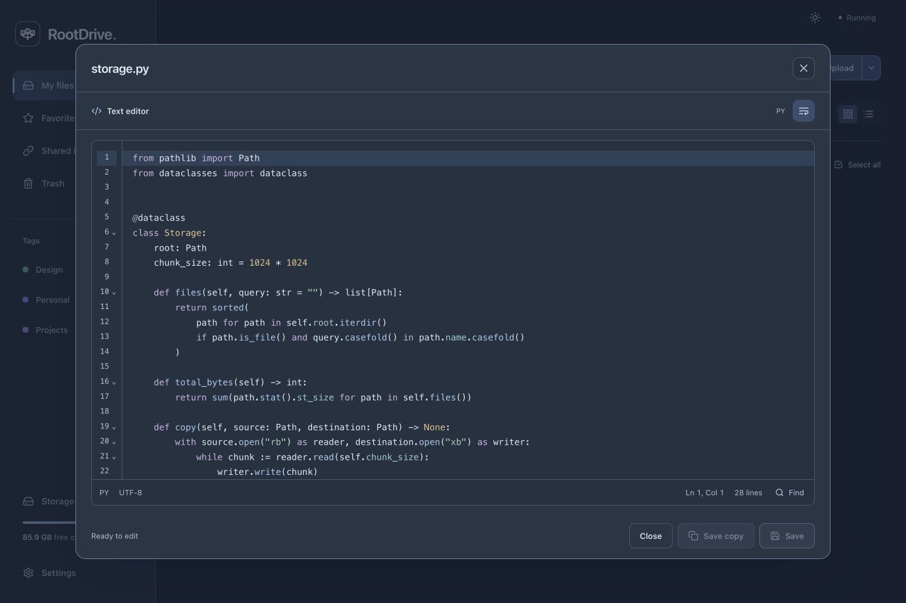
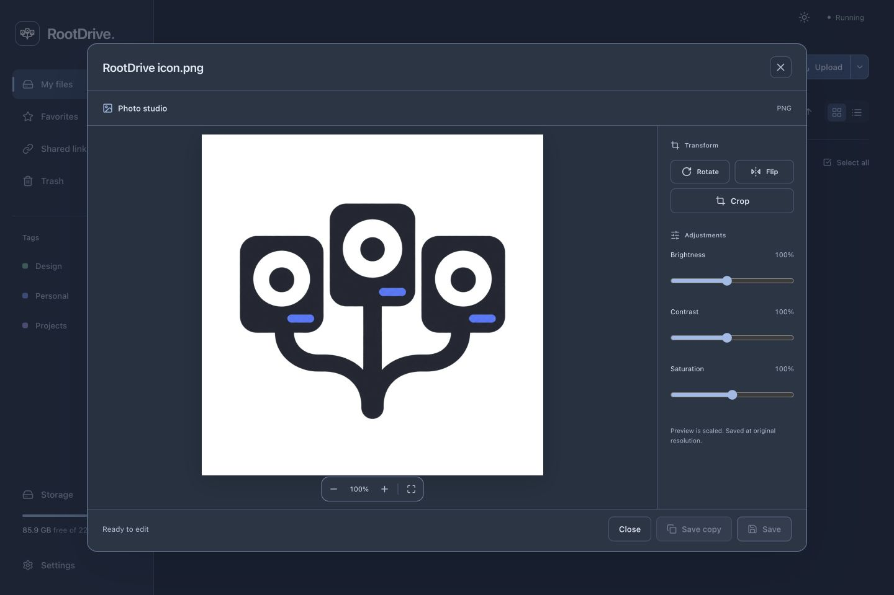
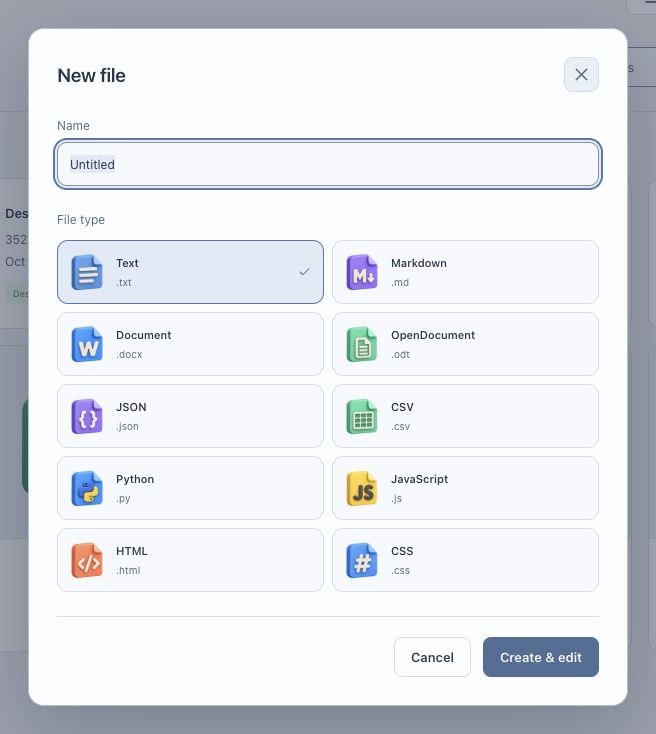
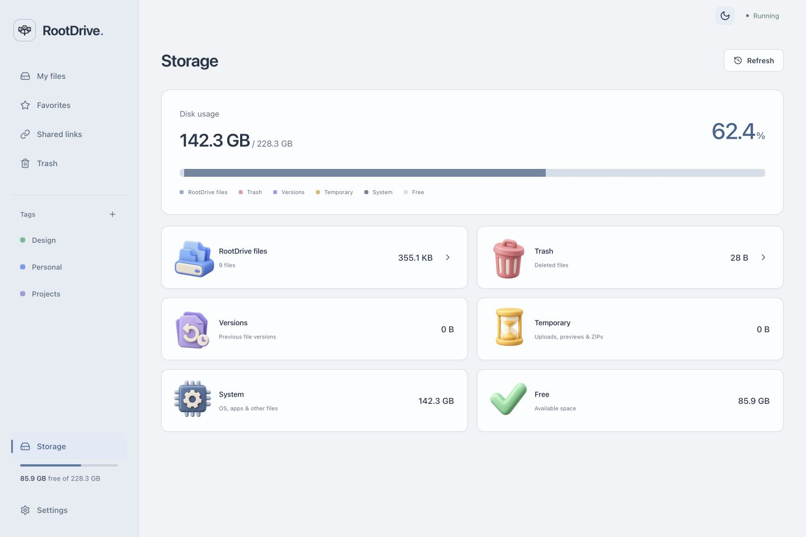
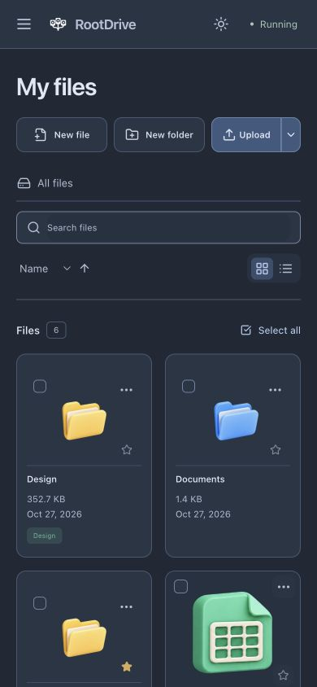
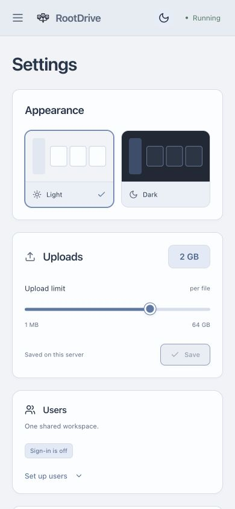

Keep your files on your own computer. Open them from any browser.

No cloud account. No subscription. No Docker.

**[Start](#start-here) · [Updates](docs/UPDATES.md) · [Full guide](docs/GUIDE.md)**

## Your files

Upload, search, move and download. Keep folders, favorites and tags in one place.

<picture>
  <source media="(prefers-color-scheme: dark)" srcset="docs/screenshots/files-dark.png">
  
</picture>

## Find it faster

Smart folders collect recent files, photos, documents and files of 100 MB or more from across your workspace.


Press **⌘K / Ctrl+K** to find a file, jump to a section or run a command. **F2** renames; **Delete** opens the Trash confirmation. Sorting and recent commands are remembered.


## Start here

You need **Python 3.11+**. For local setup, also install **Node.js 22.13+ and npm**. Works on Linux and macOS; use WSL2 on Windows.

From the project folder:

```sh
./start.sh
```

Choose **Start RootDrive**, then open [localhost:8000](http://127.0.0.1:8000).
The launcher prepares the app on its first run. Stop it with `./stop.sh` or **Ctrl+C**.

For a Linux server, choose **Install as a Linux server** in the same menu.

## Open. Edit. Save.

Edit text and code with line numbers and syntax colors. Save the original or a copy.



Crop, rotate and adjust images. Basic document editing and PDF tools are included too.



## Create ZIPs

Right-click a folder → **Create ZIP**. Save the archive beside the folder.

<p align="center">
  
</p>

## Create something new

Start a note, a document or a code file without leaving the panel.

<p align="center">
  
</p>

## Bring files back

Search and sort Trash. Select several files to restore them together.


## See your space

Files, trash, versions, system usage and free space — all together.



## Light, dark, and mobile

<table>
  <tr>
    <td align="center"></td>
    <td align="center"></td>
  </tr>
</table>

## A little more

- Files stay in `storage/` during a local installation. Documents, Photos, Videos and Audio are created once on first launch.
- Login and public links are optional and off by default. Users share one workspace.
- Trash supports search, sorting and restoring multiple selected items. Signed-in users can change their password in Settings.
- Public links let anyone with the link download the file.
- For LAN access, set `HOST=0.0.0.0` in `.env` and restart.

Built as a university Python project: **FastAPI** for the API, **Python filesystem services** for files, and **SQLAlchemy + SQLite** for metadata. The interface uses React and TypeScript.

[Setup, security, tests and limitations →](docs/GUIDE.md)

### Albums and archives

Photos opens a gallery grouped by modification date. Select photos to add them to a virtual album; deleting an album leaves the original files intact. Use arrow keys in the viewer or start a slideshow.

Open a ZIP to browse or download its members, or extract selected items into a new folder. Unsafe paths, links, encrypted archives and excessive expansion are rejected. The default extraction budget is 10 GB (`MAX_ARCHIVE_EXPANDED_MB`). Copy/cut/paste work from the context menu and with Ctrl/Cmd+C, X and V. Drag a file onto a folder to move it.

### Find inside files

Discover searches UTF-8 notes, source code, DOCX and ODT text. Each search checks up to 2,000 supported files for 15 seconds; text files over 2 MB and unsupported documents are skipped and reported. Narrow the folder for large libraries. Duplicate scans compare SHA-256 contents with a SQLite cache, use a 30-second / 100,000-file budget and display partial results when reached. Nothing is deleted automatically.

### Share files and folders

Sharing stays disabled unless `ENABLE_PUBLIC_SHARES=true`. Create a link from a file or folder menu, choose an expiry and optionally set a password (8 characters minimum). Folder links allow browsing and downloading only that folder's contents. Anyone with the link and password can access those contents without an account. Passwords use Argon2; unlock grants are HttpOnly cookies valid for at most one hour. Revoke a link in Shared links to immediately end access. Use HTTPS outside a trusted LAN, including for link passwords.

### Photo exports

Select up to 20 photos and choose **Export photos** from a file menu. Choose JPEG, PNG or WebP, quality and maximum dimensions, then preview and save copies next to the originals. Images retain their aspect ratio and are never enlarged. EXIF/GPS removal is on by default. Add text or find an uploaded logo for a watermark. Processing runs one image at a time; a failed batch rolls back its copies.

RAW previews use embedded JPEGs in CR2, CR3, NEF, ARW, DNG, ORF, RW2 and RAF containers where available. This is not RAW development: no demosaicing or camera colour processing. The reader checks the first 128 MB and accepts embedded JPEGs up to 16 MB; unsupported files keep their download option.

### Creative workspace

Pin a folder from its menu; unpin it with the sidebar ×. Pins, albums and playlists follow files renamed or moved through RootDrive. Markdown files have a side-by-side preview with headings, lists, links, quotes and fenced code. Raw HTML is shown as text; remote images and scripts are never executed.

DOCX and ODT editors can apply whole-paragraph bold/italic, headings, bullet/numbered lists and append new paragraphs. Complex embedded paragraphs stay locked and are preserved. This is a paragraph editor, not a page-layout replacement for Word or LibreOffice. Save the original with a version backup or save a separate copy.

Audio lets you create persistent playlists. The native player stays active while navigating RootDrive and streams with HTTP byte ranges. Browser format support determines which tracks can play; files remain downloadable.
