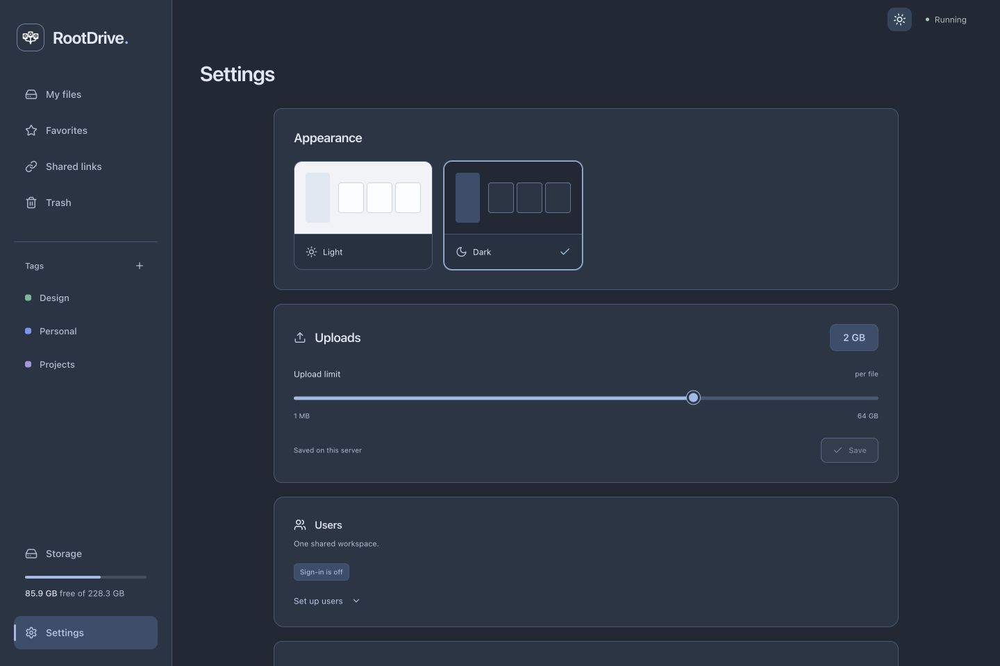

# RootDrive guide

[← Back to the README](../README.md)

RootDrive is a lightweight personal file server with a Python backend and a responsive React interface. Run it on an old laptop, desktop, mini PC, Linux server or Raspberry Pi. The built application runs through one HTTP port and needs no persistent Node process, Docker, cloud account, API key or external service.

Created as a university Python semester project. The implementation demonstrates a REST backend, safe filesystem operations and relational metadata persistence.

## Implemented features

- Browse folders in grid or list view; breadcrumbs and file selection.
- Multiple files and folder uploads with hierarchy, drag and drop, per-file progress and configurable limits.
- Persistent chunked uploads with pause/resume, reconnect retries and reselecting originals after a page reload.
- Favorites, colored tags, tag filtering and custom folder colors.
- Page selection and bulk move, trash or ZIP download; individual folders download as ZIP. Create ZIP also saves a folder archive inside the workspace.
- Version history on explicit replacement, previous-version downloads and safe restoration.
- Native browser audio/video playback with HTTP byte ranges.
- Download, create folder, rename, move and delete to trash.
- Restore deleted items or permanently remove individual trash items.
- Case-insensitive filename search, optional recursive search and pagination.
- Sort by name, modification date, size or type.
- JPEG, PNG, WebP, GIF, HEIC, HEIF, AVIF and PDF previews.
- Cached photo thumbnails and file properties with expandable camera/lens EXIF metadata.
- Disk breakdown into RootDrive files, Trash, Versions, Temporary data, System and Free space.
- Light and dark themes with a saved appearance preference; file search beside the file toolbar.
- Optional login, multiple accounts, administrator-created users and logout.
- Optional expiring public download links and link revocation.
- Original illustrated file/folder icons, a minimal 2D disk-and-roots application mark and mobile navigation.

Finder `.DS_Store` metadata is hidden from file listings and file totals.

Nothing is uploaded to a third-party service. Runtime does not load fonts, scripts or images from a CDN. On first launch, Documents, Photos, Videos and Audio are created in the workspace. No example files are installed. Existing names are preserved, and the folders are not recreated after being renamed or deleted. This setup state is stored in SQLite for each configured storage path. Set `CREATE_DEFAULT_FOLDERS=false` to start without them.

## Requirements

- Python 3.11 or newer.
- Node.js 22.13+ and npm for developing/building the frontend.
- Linux or macOS; ARM64 and x86-64 are supported targets.
- A writable local disk with enough space for files, temporary uploads and trash.

The backend deliberately uses `O_NOFOLLOW`, available on Linux and macOS. Native Windows deployment is not currently supported; use WSL2. Any computer running a supported operating system can host RootDrive. Raspberry Pi is one option, not a requirement.

## Install and start

```bash
cd ~/Documents/rootdrive
./start.sh
```

In an interactive terminal, the launcher offers **1. Start RootDrive**, **2. Install as a Linux server**, or **0. Exit**. Enter selects the ordinary launch. `./start.sh --start` skips the menu, and noninteractive invocations without arguments retain the ordinary launch behavior.

The ordinary launch prepares and launches the application. It finds Python 3.11+, creates `.venv` if missing, installs missing/incompatible Python dependencies, creates `.env` only when absent, installs frontend dependencies when needed, and rebuilds the frontend when its source changes. The launcher shows four setup stages and a compact disk-and-roots terminal mark. ANSI colors are enabled only for interactive terminals; set `NO_COLOR=1` to disable them. Repeat launches reuse the prepared environment without network access. Existing `.env`, user files and databases are preserved. It works when invoked from another directory, including project paths containing spaces.

Python itself must already be installed. Node.js and npm are required to build the frontend; once the build is prepared, startup does not require Node.js. If a required system runtime is missing during an ordinary launch, the script prints an actionable message. System package installation is handled separately by the server installer.

To prepare the installation without starting the server:

```bash
./start.sh --install-only
```

Stop a foreground launch with **Ctrl+C**, or run `./stop.sh` from another terminal. If RootDrive is already listening on the configured address, the launcher reports that instead of starting a second instance. A conflicting server on the configured port must be stopped or `PORT` changed.

### Automatic Linux server installation

From a trusted copy of this project, run:

```bash
./start.sh --server-install
```

Or choose option 2 in `./start.sh`; the same launcher handles installation and ordinary startup. Administrator access is required; the script uses sudo when invoked by a regular user.

Use a current 64-bit Linux installation: Debian 12+, Ubuntu 24.04+, Raspberry Pi OS 64-bit Bookworm or newer, or a current Fedora/Arch system. Automatic system dependency setup supports apt, dnf and pacman. Python 3.11+ with venv must be available from the distribution. No third-party Python repository is added. Native Windows and macOS use the ordinary launcher instead; WSL2 can use Linux installation, with `--no-service` if systemd is unavailable.

The installer installs system prerequisites, creates the unprivileged `rootdrive` account, copies application code to `/opt/rootdrive`, creates a virtual environment, installs Python/npm dependencies and builds the frontend. It reuses a supported Node.js runtime or downloads the appropriate x86-64/ARM64 Node.js 24 archive from the [official distribution](https://nodejs.org/dist/latest-v24.x/), verifies its published SHA-256 checksum, and installs it inside `.runtime/node`. npm and Python setup run as the service account. Application code becomes root-owned and readable/executable by the service group after setup. The service runs Python directly; Node.js is needed only for builds.

| Location | Purpose |
| --- | --- |
| `/opt/rootdrive` | Installed application, dependencies and frontend build |
| `/opt/rootdrive/.env` | Installed server configuration |
| `/var/lib/rootdrive/storage` | Stored user files |
| `/var/lib/rootdrive/data` | SQLite database and internal trash/versions/cache |
| `/etc/systemd/system/rootdrive.service` | Managed systemd service |

Run from a source checkout outside the installation directory, such as `~/rootdrive`. Existing source workspace files, databases and `.env` are not copied or migrated. Existing installed configuration and data are preserved on repeat installation. Stop any ordinary RootDrive launch on the same port before installing the service; an occupied port is reported without terminating unrelated processes. Nonempty unmanaged application/data directories and existing unmanaged units are rejected. The installer stops its managed service during repeat setup; if setup fails, fix the reported issue and rerun it. Migration to different application/data paths must be handled explicitly.

```bash
./start.sh --server-install --install-dir /opt/rootdrive --data-dir /var/lib/rootdrive
./start.sh --server-install --no-service
```

`--no-service` installs without systemd or automatic startup. Run the printed Python command as the `rootdrive` account. A normal installation enables startup at boot, verifies the application's health endpoint and exposes these controls:

```bash
sudo systemctl start rootdrive
sudo systemctl stop rootdrive
sudo systemctl restart rootdrive
sudo journalctl -u rootdrive -f
```

The [systemd service](https://www.freedesktop.org/software/systemd/man/latest/systemd.service.html) uses `Restart=on-failure`, an unprivileged user, a private temporary directory and restrictive file creation permissions. Use systemctl for the installed service; `stop.sh` continues to manage ordinary project launches.

Initial server settings bind to `127.0.0.1:8000`, with optional authentication and public sharing disabled. The installer does not modify the firewall, publish the server or replace existing installed settings. For a VPS, reach it initially with an SSH tunnel:

```bash
ssh -L 8000:127.0.0.1:8000 user@YOUR_SERVER
```

Then open `http://127.0.0.1:8000`. For trusted LAN access, edit the installed `.env` with `sudo`, set `HOST=0.0.0.0`, and restart the service. For an internet-facing deployment, configure authentication and HTTPS before exposing the port. Create an administrator with:

```bash
sudo -u rootdrive /opt/rootdrive/.venv/bin/python /opt/rootdrive/run.py create-admin
```

Set `AUTH_ENABLED=true` in the installed `.env` and restart the service to require login. Back up the installed `.env` and `/var/lib/rootdrive` before maintenance.

Installer tests use temporary directories, fake package-manager/service commands and a pseudo-terminal; they do not install packages, create real users, change system units or touch user files. Actual privileged installation on Linux hardware is a separate deployment check.

### Manual installation

Run all commands from the project directory:

```bash
cd ~/Documents/rootdrive
python3 -m venv .venv
source .venv/bin/activate
python -m pip install -r requirements.txt
cp .env.example .env
npm --prefix frontend install
npm --prefix frontend run build
python run.py
```

Open <http://127.0.0.1:8000>. API documentation is at <http://127.0.0.1:8000/docs>.

`requirements.txt` declares the supported dependency ranges. `backend/requirements.lock.txt` captures the exact Python environment used for verification; use it with Python 3.12 for the closest reproduction. `frontend/package-lock.json` is the npm lockfile; use `npm --prefix frontend ci` for repeatable frontend installs.

## Stop the server

```bash
./stop.sh
```

The companion script uses the same terminal design as the launcher. It requests graceful shutdown of the server started from this project with `./start.sh` or `python run.py`. It reports when the server is already stopped and waits briefly for active requests to finish. It never force-kills pending uploads. Run it as the same operating-system user as the server. The control channel is a private Unix socket under `/tmp/rootdrive-UID`, keyed to the project directory identity, so another project or a different process on the HTTP port is not targeted. A stale socket is safely replaced on the next launch. It needs Python 3.11+, with no third-party modules or installation step.

For a foreground `python run.py` process, **Ctrl+C** also works. Development servers launched directly with `uvicorn` are stopped in their own terminal; `stop.sh` manages the project launcher. For a background process, find the listening process with `lsof -nP -iTCP:8000 -sTCP:LISTEN`, then send `kill PID` to that RootDrive process. Replace `8000` if you changed the port. For a systemd deployment, use `sudo systemctl stop rootdrive`.

## Development

Backend terminal:

```bash
source .venv/bin/activate
PYTHONPATH=backend uvicorn app.main:create_app --factory --reload --host 127.0.0.1 --port 8000
```

Frontend terminal:

```bash
npm --prefix frontend run dev
```

Open the Vite URL printed in the terminal, normally <http://127.0.0.1:5173>. Vite proxies `/api` to the Python server. Restart the backend after changing `.env`.

## Production

```bash
npm --prefix frontend ci
npm --prefix frontend run build
source .venv/bin/activate
python run.py
```

FastAPI serves `frontend/dist` and `/api` on the same port. Node.js can be stopped after the build. Run **one application worker**: filesystem mutation locking is intentionally process-local. Use a regular service account, not root. A process manager such as systemd can keep the server running.

Example Linux systemd unit, with paths adjusted to your installation:

```ini
[Unit]
Description=RootDrive personal file storage
After=network.target

[Service]
User=rootdrive
WorkingDirectory=/opt/rootdrive
ExecStart=/opt/rootdrive/.venv/bin/python /opt/rootdrive/run.py
Restart=on-failure
UMask=0077
NoNewPrivileges=true

[Install]
WantedBy=multi-user.target
```

Save it as `/etc/systemd/system/rootdrive.service` and run `sudo systemctl enable --now rootdrive`. Create the service user and give it access to the project and storage first. This is a manual alternative. `start.sh --server-install` creates and manages a unit automatically.

## Configuration

Copy `.env.example` to `.env`. Relative paths are resolved from the project directory. Real `.env` files, uploaded files and databases are ignored by Git.

| Variable | Default | Meaning |
| --- | --- | --- |
| `HOST` | `127.0.0.1` | Address used by `python run.py` |
| `PORT` | `8000` | HTTP port |
| `STORAGE_PATH` | `./storage` | Browsable user files |
| `DATABASE_PATH` | `./data/rootdrive.db` | SQLite metadata |
| `INTERNAL_PATH` | `./data/internal` | Trash, versions, upload staging, preview cache and ZIP exports |
| `CREATE_DEFAULT_FOLDERS` | `true` | Create the four starter folders once per configured workspace |
| `AUTH_ENABLED` | `false` | Require login |
| `ENABLE_PUBLIC_SHARES` | `false` | Enable anonymous file download links |
| `COOKIE_SECURE` | `false` | Restrict session cookies to HTTPS when true |
| `MAX_UPLOAD_SIZE_MB` | `2048` | Initial per-file limit; a saved Settings override takes precedence |
| `SESSION_HOURS` | `24` | Session duration |
| `MAX_PREVIEW_PIXELS` | `50000000` | Maximum decoded photo size for thumbnails/previews |
| `MAX_ARCHIVE_EXPANDED_MB` | `10240` | Maximum combined uncompressed ZIP extraction size |
| `PREVIEW_CACHE_SIZE_MB` | `512` | Derived JPEG preview cache limit |

Storage must not contain application code, the database, `.env` or the internal directories. Keep `STORAGE_PATH` and `INTERNAL_PATH` on the **same filesystem** for rename-based trash operations and atomic ZIP publication. For an external disk, use sibling paths such as `/mnt/drive/files` and `/mnt/drive/rootdrive-internal`. The database can remain on the host disk.

## Upload limit in Settings

Settings → Uploads provides a slider from 1 MiB to 64 GiB per file, with power-of-two steps. Choose a value and press Save. Existing custom values from configuration are retained as an additional slider position. The backend accepts validated settings up to 1 TiB. Changes take effect immediately and persist in SQLite's `application_settings` table; a saved value overrides the environment default after restart. The `.env` file is not rewritten.

With authentication enabled, only administrators can save the limit and CSRF protection is required. Members can see the current limit. With authentication disabled, the shared workspace can change it. Reducing a limit also applies to unfinished transfers: chunks and completion are rejected while a file exceeds the current limit; raising the limit allows those transfers to resume. Existing stored files are unaffected. The multipart request-body guard reads the current limit for each new request.

## Local network access

Set the following in `.env`, then restart:

```dotenv
HOST=0.0.0.0
```

Find the server's LAN address and open `http://SERVER_LAN_IP:8000` from another device on the same network. Allow the configured port in the server firewall. RootDrive does not configure routers, expose ports to the Internet or open firewall rules automatically.

On a trusted LAN, HTTP works with `COOKIE_SECURE=false`. For passwords and remote access, terminate HTTPS with a correctly configured reverse proxy and set `COOKIE_SECURE=true`. Use a VPN or properly secured proxy for access beyond your LAN. Do not forward the unauthenticated default service to the public Internet.

## Authentication

Authentication is disabled by default. The UI hides login and account controls in this mode. Account-creation endpoints remain protected and cannot be used to create an administrator.

Create the initial administrator with a hidden password prompt:

```bash
source .venv/bin/activate
python run.py create-admin --username admin
```

Then set `AUTH_ENABLED=true` and restart. Passwords must contain at least ten characters. Passwords are hashed with Argon2id. The CLI does not accept passwords as command-line arguments.

Administrators can list users and create member or administrator accounts in Settings → Users, or through `GET /api/auth/users` and `POST /api/auth/users`. There is no open registration. When authentication is off, Settings shows instructions for creating the first administrator through the CLI and enabling authentication. The original **shared workspace** remains available to all signed-in users. Each account also has a separate personal space, and owners can invite existing accounts to named shared spaces with reader/editor access. Select the active space in the sidebar. Each space has separate files, metadata and internal data.

Sessions use random tokens in HttpOnly, SameSite=Strict cookies; only token hashes are stored in SQLite. The frontend keeps the CSRF token in memory and includes it on mutations. Session tokens are never stored in localStorage. Expired sessions are cleaned up on login. Login attempts are limited per client address in memory; a server restart resets that limit.

## Sharing

Set `ENABLE_PUBLIC_SHARES=true` to reveal sharing actions. Create a link from a file or folder menu; optionally add a password. Choose an hour, a day, a week or no expiration. Anyone with the link can download that file without signing in.

Tokens contain 256 bits of randomness and only hashes are persisted. The full link appears once when created; copy it then. The Shared links screen lists and revokes links. Existing links follow API renames and moves. Moving a file or parent folder to trash revokes its links permanently; restoration does not reactivate them. Files modified outside RootDrive cannot be tracked automatically, so revoke old links before replacing shared paths externally.

## Uploads and storage

The browser uploads files serially in chunks up to 4 MiB, writing each acknowledged offset to SQLite. Pause stops the current request and leaves completed chunks on the server. Resume refreshes the server offset before continuing. Lost connections retry up to three times and can be resumed manually. Pending uploads remain on disk across browser/server restarts; after reopening the page, use the file-selection button in Transfers to select the same original. Its name, size, modification time and first saved 64 KiB are checked before continuation. This prefix check is not a full-file content hash; keep the original file unchanged. Cancel removes only that unfinished upload. Closing a browser cannot retain its local file handle automatically.

Upload folder uses the browser directory picker. Dragging a folder uses directory-entry APIs where available. Relative paths are validated on the server and missing parent directories are created when files complete. Existing folders merge. Empty directories are not transmitted. On older browsers, upload individual files instead.

The default limit is 2 GiB per file. Filename conflicts never silently overwrite: the Transfers action **Replace & keep previous version** requires an explicit choice. Alternatively, open a file's **Version history → Upload new version**. Replacement checks that the original has not changed since the transfer started. Replacing or restoring a file saves the current complete contents in `INTERNAL_PATH/versions`. Versions are full copies, not deltas. Renames, moves, trash and restoration retain their association; permanently deleting a trash item also removes its saved versions. Files changed outside RootDrive do not generate versions. Versions and trash are never automatically emptied.

The multipart `POST /api/files/upload` API remains available for integrations. It uses FastAPI `UploadFile`, copies in 1 MiB chunks, accepts up to 20 files per request and rolls back files from a failed batch. Multipart parsing can spool data into the operating system temporary directory before per-file validation; leave enough temporary disk space. The browser's resumable route bounds each request separately and does not spool an entire large file in memory.

Bulk selection applies to the displayed page (60 entries), with up to 200 explicit paths per batch API request. Selected descendants are ignored when their parent is also selected. Bulk move and trash validate paths first and roll back completed moves on a handled failure. Folder and multi-file ZIPs are prepared on disk with bounded-memory copying, rather than assembled as browser blobs. Temporary ZIP downloads expire after one hour; expired ZIP files are cleaned when another archive is created. Archive preparation holds the application filesystem lock, so very large ZIPs can delay other file requests. Audio/video playback uses the browser's native codecs; unsupported formats can still be downloaded. There is no transcoding.

Favorites belong to the signed-in account, or to the shared workspace when sign-in is off. Tags, folder colors, versions and user files are shared. Metadata follows changes made through the API; external edits are not indexed or monitored. API renames and moves update active share links; replacing a shared file causes its existing link to download the current contents at that path.

Storage scans use streaming directory iteration and a 30-second cache. File mutations invalidate the cache. The dashboard separates active files, Trash, Versions, Temporary (unfinished uploads, preview cache and generated ZIPs), System and free disk space. **System** is the remaining used disk space after RootDrive's file and internal-data totals are subtracted, and includes the OS, apps and other files. File sizes are logical bytes; filesystem compression, sparse files, clones and APFS accounting can make this an estimate of physical allocation. Keep storage and internal data on the same filesystem for meaningful disk comparisons and rename-based operations.

A crash or power failure can leave an unfinished filesystem/metadata transition. Resumable uploads truncate any unacknowledged tail to their recorded offset on the next chunk. Missing or damaged staging requires cancelling and restarting that upload. Inspect orphaned data with the server stopped. Back up storage, the SQLite database and internal data together while the server is stopped for a consistent snapshot.

## Save a folder as ZIP

Right-click a folder or open its action menu, then choose **Create ZIP**. Edit the archive name and confirm. RootDrive saves `Folder.zip` beside `Folder`; it does not start a browser download or remove the source. Use **Download ZIP** for the existing temporary download workflow instead.

`POST /api/files/compress` accepts `path` and an optional `name`. It rejects root paths, files, symlink roots, unsafe names and destination conflicts. ZIPs contain the selected folder, nested files and empty directories; symlinks and `.DS_Store` are excluded. Nested folder archives start with the selected folder name rather than unrelated workspace ancestors. File contents stream in 1 MiB chunks, with ZIP64 and fast level-one compression. A completed archive is published using an exclusive hard link from internal staging, so incomplete archives are not listed and existing files are not overwritten. Failed operations remove their staging files. Storage and internal data must share a filesystem. Compression is synchronous under the workspace lock; very large folders can delay other workspace requests while it runs.

## Photo previews and EXIF

Photo cards load lazy 640-pixel JPEG thumbnails. HEIC/HEIF and AVIF previews are converted to JPEG with a maximum 1920-pixel edge so browsers can display them. Downloads always return the original file. Pillow and pillow-heif run locally, with at most two conversions at a time, and respect the pixel limit. The first preview can take longer on slower hardware. Supported-platform wheels bundle the HEIF decoder; source installs may require libheif development packages.

Derived files live in `INTERNAL_PATH/previews`, outside browsable storage. Cache keys include the source path, modification time, change time and size. The oldest derived files are removed when the configured cache limit is exceeded. Preview generation never changes original files or their EXIF.

Properties includes a collapsible EXIF section with available camera make/model, lens, ISO, exposure, aperture, focal length, capture time, software and other selected fields. Dimensions and values are read from the original; absent metadata is not invented. Public links still share the original file, including whatever metadata that original contains.

## Create files

Use **New file → Create & edit** to create a UTF-8 text/code file or a minimal valid DOCX/ODT document in the current folder and open its editor. The icon tile type picker supports keyboard radio selection and includes TXT, Markdown, DOCX, ODT, JSON, CSV, Python, JavaScript, HTML and CSS. JSON starts with an empty object; other text files start empty. Documents start with one empty editable paragraph. `POST /api/files` accepts `path` and `name`, validates the parent and filename, and rejects conflicts without overwriting. Creation uses internal staging, the shared filesystem lock and existing session/CSRF protection. Closing the editor leaves the new file in place. Save updates that file; Save copy creates a separate edited copy.

## Built-in editors

Open a text file or DOCX/ODT document to edit it. Images and PDFs have an **Edit** action in their preview and file menu. Use **Save** or **Ctrl/Cmd+S** to update the original and keep its previous contents in Version history. Use **Save copy** or **Ctrl/Cmd+Shift+S** to create an independent file in the same folder. Both actions close the editor after success. Copies are named `name (edited).ext`, `name (edited 2).ext`, and so on; existing files, folders and symlinks are never chosen as a copy destination. Unsaved changes require confirmation before closing. There is no automatic save.

| Editor | Implemented operations | Limits |
| --- | --- | --- |
| Text and code | UTF-8 text, Markdown, JSON, CSV/TSV, configuration and common code formats; line numbers, syntax highlighting, folding, bracket matching, indentation, search/replace, line wrapping and undo/redo | 2 MiB encoded text; UTF-8 BOM and uniform CRLF endings retained |
| Photo | Crop by dragging or keyboard-accessible edge sliders, clockwise rotation, horizontal flip, brightness, contrast and saturation | JPEG, PNG, WebP, HEIC/HEIF and AVIF; 64 MiB and `MAX_PREVIEW_PIXELS`; animated images excluded |
| DOCX / ODT | Change existing paragraph and table-cell text, line breaks, tabs and spaces while retaining text-run styles and other package entries | 32 MiB file, 64 MiB uncompressed package, 8 MiB content XML, 3,000 paragraphs, 2 MiB text; one changed paragraph up to 100,000 characters |
| PDF | Reorder, rotate and remove pages with real locally rendered thumbnails | 32 MiB, 500 pages; at least one page retained; encrypted PDFs, forms and detected signed documents excluded |

The editor API accepts `mode: original` or `mode: copy` (the default for API compatibility). Original saves retain metadata and share links; those links serve the current file. A previous version is captured before replacement. Copies do not inherit share links, favorites or tags. Replacement uploads and explicit version restoration also keep previous contents in **Version history**. Saving checks a revision based on file identity, size and nanosecond timestamps; stale changes return HTTP 409. Validation and transformation finish in an internal staging file before installation. Database failures remove an incomplete copy or restore the previous original and roll back its version metadata. Authenticated saves use the existing session and CSRF protection. The configurable upload limit also applies to saved output.

The photo editor shows a JPEG preview with a maximum 1920-pixel edge. Final processing uses the original image at its full resolution. Transformations apply orientation, clockwise rotation, flip, normalized crop, then color adjustments. Alpha is retained where the output format supports it; available EXIF and ICC data are passed through with orientation and dimensions updated. JPEG/HEIF/WebP/AVIF saves re-encode the image and may change compression, color rendering or auxiliary metadata. The browser uses CSS filters for responsive live adjustments, including browsers without Canvas filter support. This approximates the saved color rendering. Photo previews and the photo editor have 25–800% zoom, double-click zoom, fit/reset, Ctrl/Cmd+wheel zoom and drag-to-pan when enlarged. Zoom only changes the view and is never saved into the image. Crop mode temporarily fits the image so drag selection remains precise. Save copy keeps the source next to its edited copy; Save retains the previous source in version history.

The Office editor changes text, rather than reproducing a word processor's page layout. It supports whole-paragraph bold/italic, headings, bullet/numbered lists and appending new paragraphs. Deleting/reordering existing paragraphs and full page layout are not included. Paragraphs containing links, fields, drawings, tracked changes or other complex constructs are locked and preserved. Headers, footers, embedded media and other ZIP entries remain in the file. XML external entities and DTDs are rejected, and package contents are never extracted onto the server filesystem. Existing run styles are retained and inserted text inherits an adjacent run. Detected package signatures are rejected because editing would invalidate them.

The PDF editor manages pages, not existing PDF text or images. It preserves selected pages and their content, imports associated outlines where possible and retains document metadata. Advanced annotations and PDF structures may be rewritten by pypdf. PDF.js, its worker, fonts, character maps and WebAssembly resources are bundled locally; opening the editor makes no CDN requests. The editor and PDF renderer are loaded on demand, so the normal file manager keeps its small initial bundle.

Old binary Office formats, XLSX, PPTX, rich-text RTF, video/audio editing, OCR, arbitrary PDF text editing and real-time collaboration are not implemented. Supported files keep their normal preview/download actions. Invalid, excessively large or unsupported files show an explicit editor error without changing the original.

## Trash

Trash supports the same desktop selection rectangle and mobile checkboxes as My files, using unique trash IDs so repeated deletions of the same path remain distinct. The toolbar switches to **Remove selected** when files are selected; otherwise **Remove all** clears every page of Trash and associated saved versions after explicit confirmation. The confirmation uses a revision of the complete trash listing; if items were added or restored, the server returns HTTP 409 and requires a refreshed confirmation. Trash payloads and version files are staged outside storage before the metadata transaction. A database or staging failure rolls back staged files. Irreversible removal only follows a successful commit. Active files are unaffected.

## Smart folders and quick commands

**Smart folders** are virtual views across the shared workspace. They do not create directories, duplicate files or move the originals. File actions affect the file at its displayed path. Search, sorting, pagination, selection, favorites, tags and previews work as in My files.

| Smart folder | Rule | Default order |
| --- | --- | --- |
| Recent files | Modified in the last seven days | Newest first |
| All photos | Common image formats, including HEIC/HEIF, AVIF and common camera RAW extensions | Name |
| Documents | Text, Markdown, PDF, Office, OpenDocument, CSV, EPUB and Apple document formats | Name |
| Large files | At least 100 MiB, displayed as 100 MB in the interface | Largest first |

Photo classification uses the filename extension; it does not promise a preview/editor for every camera RAW format. Recent files use filesystem modification time, not upload or creation time. The four views are built in. Recent files offers 7/30/90-day periods; Large files offers 10 MB, 100 MB, 1 GB and 10 GB thresholds. These preferences are remembered in this browser. Arbitrary custom saved rules are not included.

`GET /api/smart-files?kind=recent|photos|documents|large` uses the same authentication and storage restrictions as ordinary listings. It supports `q`, `sort`, `direction`, `offset` and `limit` (up to 200), plus `recent_days` (1–365) and `min_size_mb` (1–1048576). Files in Trash, internal directories, symlinks and `.DS_Store` are excluded. Scans read filesystem metadata only and keep a bounded sorted page in memory. At most twelve raw result pages are cached for fifteen seconds; application writes invalidate them. Favorites and tags are enriched for the current user after reading the cache. External filesystem edits can take up to fifteen seconds to appear. Initial scans remain proportional to the tree size; no background indexer or polling loop is added.

Open **Quick commands** from the top bar or press **Cmd+K / Ctrl+K** outside an editor/dialog. Type to filter commands or search filenames across all folders. File searches start at two characters, are debounced and return at most eight results; obsolete requests are aborted. No file-search request runs while the panel is closed or its input is empty. Use Up/Down and Enter, or click/tap a result. Escape closes the panel and returns focus to its trigger. The panel is also available on mobile through its top-bar icon.

Commands open normal views, create a file/folder, upload files, refresh or switch theme. Creation and upload target the current physical directory; from a virtual view or Settings they target My files. A single selected file/folder also exposes Rename and Properties. Existing dialogs and backend validations perform the actual operations. There are no quick commands for permanent deletion. The last five general command IDs appear first when the palette opens; **Clear history** removes them. Each username/shared workspace has its own browser-local list. File-specific actions, paths, filenames and search queries are not saved.

### Keyboard, navigation and selection

F2 renames one selected file/folder; Delete opens Move to Trash confirmation. Shortcuts ignore text entry, repeated key events, active dialogs, pending actions and Trash. They do not permanently delete files. **Open file location** in the context menu or palette opens the physical parent folder, resets sorting to name ascending and selects the original item. `GET /api/files/location?path=…&limit=60` computes the target page directly without fetching all intervening pages; access and path checks are the same as downloads.

Sort field and direction persist in browser preferences for ordinary file views, each smart folder and Trash. Unsupported saved values fall back to safe defaults. The selection toolbar shows total size; files nested inside a selected folder are counted once. Trash uses independent item IDs, so separate deleted copies remain separate in totals.

### Trash filtering and batch restoration

Trash searches filenames and original paths using an escaped, case-insensitive SQLite substring query (SQLite's built-in lowercasing primarily covers ASCII). Sort by deletion date, original path or size; search and pagination run on the backend. The revision always covers the whole Trash. **Remove all** is disabled while a filter is active, and its existing confirmation remains mandatory after clearing the filter.

Select items and choose **Restore selected**. `POST /api/trash/restore/batch` accepts 1–200 IDs, deduplicates them and restores selected parents before children. All selected items restore in one metadata transaction; a path conflict, missing parent, unavailable item or database failure rolls back files and metadata together. Existing destinations are never overwritten. Single-item restoration remains available.

### Account password changes

With authentication enabled, every signed-in user can open Settings → Account security → Change password. `POST /api/auth/password` requires the current password and a new 10–1024-character password, the session cookie and CSRF token. Attempts are limited to five per user per five minutes. Successful changes rotate the current HttpOnly/SameSite cookie and CSRF token, retain this session with the new token, and revoke all other sessions for that user. The Argon2 hash and sessions change in one transaction; a commit failure keeps the old password and session. The browser clears password fields on success/cancel and never persists them. No password-change endpoint is available when authentication is disabled.

### Server availability

The header checks server availability after 45 seconds without successful API traffic while the page is visible and online. Routine successful checks do not animate or reload files. Transport failures show **Retry connection**; failed health checks retry after five seconds and time out after eight. Checks pause while hidden/offline and abort on unmount. Focus, restored connectivity and explicit retry can check immediately. Intentional request cancellation does not report a lost server. A successful reconnection refreshes account, tags and file listings without closing an open editor. Running indicates a responding server, not a guarantee that every storage operation will succeed.

## Folder details

Folder cards, list rows and properties show recursive file size and immediate item count. Empty folders use a matching ImageGen icon atlas without paper sheets. A folder containing a subfolder is considered occupied even when its total size is zero. Symlinks and `.DS_Store` are excluded. Folder totals are cached for 30 seconds and invalidated by application writes; external filesystem edits can take up to 30 seconds to appear. The first scan of a large tree can take time; only filesystem metadata is read, never file contents. Ordinary name-sorted listings calculate details for the returned page; sorting by size calculates totals for candidate folders.

## Editor and performance

The CodeMirror 6 text editor loads only when an editor opens. Python, JavaScript/TypeScript/JSX, HTML, CSS, JSON, Markdown and SQL parsers load on demand. Other supported text files retain plain-text editing. Line numbers, folding, bracket matching, local search/replace, autocomplete, two-space indentation and undo/redo operate entirely in the browser. Ctrl/Cmd+F searches inside the editor; Ctrl/Cmd+S saves the original and Ctrl/Cmd+Shift+S saves a copy. Escape followed by Tab leaves the code field. The existing 2 MiB text limit remains in place. Only the visible document viewport is rendered; text is serialized for saving rather than on every keystroke. Undoing back to the initial document clears its unsaved state.

Upload progress uses an external store subscribed to by the transfer queue, so it does not rerender the file manager. Progress notifications are limited to one per 100 ms; control changes and completion publish immediately. Completed files coalesce listing refreshes over 200 ms, and no retry timer is scheduled unless a transfer is waiting for a connection. Retry scheduling pauses while the page is hidden or offline; restoring visibility or connectivity resumes eligible transfers. Superseded listing, search, statistics and editor requests are aborted in the browser. This does not interrupt a synchronous filesystem scan that has already begun on the server.

File cards are memoized with stable action handlers. Opening menus and typing in the search field do not rerender unchanged cards; selection updates only affected cards. Recently visited file and Trash pages are held in a bounded in-memory cache of twelve pages for up to fifteen seconds. Revisiting shows the cached page immediately while the server validates it again; unchanged results preserve card identities. Writes, account changes and the Refresh action invalidate the cache. This cache is never persisted to browser storage. Leaving Storage does not request a redundant disk inventory.

The selection rectangle is updated independently of React. Card bounds are measured once at gesture start rather than on every pointer frame. Frames are scheduled only for pointer motion, external scrolling or active edge autoscroll; stationary dragging and clamped scrolling do not spin a frame loop. Hiding the page cancels selection and restores its starting state.

Image source descriptors are validated and opened under the filesystem lock. JPEG/HEIC thumbnail decoding then runs outside that lock, with at most two conversions at once and duplicate cache-key requests sharing a conversion. The browser may store private thumbnails but must revalidate them with a revision-derived ETag on reuse. Authentication and storage-path checks run before a 304 response; private metadata retains `no-store`. Revalidation sends no image body when the source is unchanged. Preview cache pruning is amortized over 30 seconds or one eighth of the configured cache budget in newly generated bytes. The cache can temporarily exceed its budget by that allowance or one large preview. The rotated photo-preview surface is reused while changing crop bounds.

Cold scans of very large directory trees, size sorting and storage inventory remain proportional to the number of files. Folder/statistics snapshots retain their 30-second lifetime. Indexed search is a future improvement. Network and disk speed still determine transfer speed; no hardware-independent speed multiplier is claimed.

## Interface and motion

The light and dark themes share a slate-blue design system in `frontend/src/design.css`: muted blue accents, layered panels, consistent borders and focus states, compact desktop folder cards, a grouped file toolbar and responsive mobile layouts. Settings theme previews use the same palette. Primary text, secondary text and primary button color pairs meet at least 4.5:1 contrast in both themes. Existing generated artwork is reused locally.

Click anywhere on a file/folder card or list row to open it, including the artwork, metadata and padding. One native button spans the surface and remains keyboard accessible. Selection checkboxes, favorites, context menus, tags and trash actions remain separate controls. Storage's RootDrive files and Trash cards also open across their full surface. Storage cards and artwork have a brief 140 ms hover motion on fine pointers; reduced-motion mode disables movement.

Right-click a tag in the sidebar or on a file card and choose **Delete tag** to remove it after confirmation. This removes the tag and its file associations. Shift+F10 or the context-menu key opens the same menu for a focused tag. Deleting the currently viewed tag returns to My files.

On desktop, drag from blank space around or below the file cards/rows to select them with a rectangle. Ctrl, Cmd or Shift adds to the current selection; an ordinary blank click clears it. Esc cancels the active gesture and restores its starting selection. Dragging near the viewport edge scrolls the page. This works in grid and list views for the current page, including Favorites and tag collections. Buttons, file opening, menus and text fields retain their normal behavior; touch scrolling and checkbox selection remain available on phones.

Language, document, folder and Storage artwork comes from the existing transparent ImageGen atlases. The interface loads individual, appropriately sized WebP variants from `frontend/public/assets/icons`, retaining transparency and the same design. It downloads only the icons used by the current view. Original PNG sources remain available; regenerate the 41 variants with `.venv/bin/python scripts/prepare_icons.py` if the artwork changes. The entire WebP set is about 600 KiB versus 8.7 MiB of original atlases and the app icon; this compares asset files rather than total application traffic. The light and dark themes share the same artwork. The Hallmark app-screen pass retains the supplied slate-blue palette and local artwork, aligns headings with file actions, increases small text sizes and removes staggered entrances, card lifts, icon filters, width animations and backdrop blur. Button press feedback takes 80 ms; state transitions take 100 ms; menus, selection tools, transfer queues and dialogs settle within 100–140 ms. These short animations indicate interaction state without delaying file display. All animation and transitions are disabled under `prefers-reduced-motion: reduce`. The header shows **Running** without duplicating the current page title.

## Python architecture

```text
backend/app/
  config.py             Environment configuration and path separation
  main.py               Application factory, middleware, errors, static frontend
  database.py           SQLAlchemy models and SQLite setup
  schemas.py            Pydantic request validation
  cli.py                Server startup and administrator creation
  control.py            Private local shutdown channel for the launcher
  routers/
    files.py            Files, folders, trash, search and storage endpoints
    auth.py             Login, logout, sessions and administrator-created users
    shares.py           Share creation, revocation and public downloads
    uploads.py          Persistent upload jobs, bounded chunks and completion
    settings.py         Validated live upload limit and administrator checks
    workspace.py        Favorites, tags, bulk actions, ZIPs, versions and media
    editor.py           Typed editor requests, revisions and validated saves
  services/
    filesystem.py       Path validation, listing, streaming downloads and statistics
    bootstrap.py        One-time default folders and persistent workspace setup state
    archives.py         Streamed ZIP writing and safe in-workspace publication
    security.py         Argon2 verification, session lookup and CSRF enforcement
    previews.py         Bounded photo conversion and derived thumbnail cache
    metadata.py         Read-only EXIF extraction and display formatting
    editors.py          Bounded text, image, Office XML and PDF transformations
    creation.py         Empty text files and minimal valid DOCX/ODT packages
    workspace.py        Stable item metadata, version snapshots and batch rollback
backend/tests/          Isolated API integration tests
frontend/src/           React, TypeScript, local API client and illustrated UI
frontend/public/assets/ Original locally hosted image assets
run.py                  Project entrypoint
```

Three Python technological areas for the university demonstration:

1. **Web backend and REST API.** FastAPI uses an application factory, dependency-based access checks, Pydantic input schemas and structured errors. Uvicorn runs the ASGI application. OpenAPI is generated at `/docs`.
2. **Filesystem operations and storage management.** `pathlib`, `os`, `stat`, `shutil`, `heapq` and chunked I/O implement isolation, bounded-memory listing, uploads, downloads, rename/move, trash, ZIP archives, version snapshots and disk statistics. Symbolic links are excluded, path components are validated and downloads open with `O_NOFOLLOW`.
3. **SQLite database and persistence.** SQLAlchemy stores users, sessions, trash records, shares, stable item identities, favorites, tags, versions, resumable upload jobs and ZIP export metadata. Each request uses its own session. SQLite runs in WAL mode with foreign keys enabled and a busy timeout. File contents remain on disk instead of becoming database blobs.

File operations use a reentrant lock to coordinate requests in a single server process. Rename and trash metadata updates attempt filesystem rollback if the database commit fails. Filesystem changes and SQLite commits cannot be one atomic transaction across a power failure.

## API

All private endpoints require a session when authentication is enabled. State-changing requests additionally require `X-CSRF-Token`. `/api/auth/me` returns the current account, configuration flags and CSRF token for an existing authenticated session.

| Method | Endpoint | Purpose |
| --- | --- | --- |
| GET | `/api/health` | Health |
| GET | `/api/files` | Paginated folder listing |
| GET | `/api/search` | Search using `path`, `q`, `recursive` |
| POST | `/api/files/upload?path=...` | Multipart `files` upload |
| GET | `/api/files/download?path=...` | Attachment download |
| GET | `/api/files/preview?path=...` | Supported inline preview |
| GET | `/api/files/thumbnail?path=...` | Cached JPEG photo thumbnail |
| GET | `/api/files/metadata?path=...` | Image dimensions and camera/lens EXIF |
| POST | `/api/folders` | Create folder with `path`, `name` |
| PATCH | `/api/files/rename` | Rename with `path`, `name` |
| POST | `/api/files/move` | Move with `path`, `destination` |
| DELETE | `/api/files` | JSON `path`, move to trash |
| GET | `/api/trash` | Paginated trash records |
| POST | `/api/trash/restore` | JSON trash `id` |
| DELETE | `/api/trash` | JSON trash `id`, permanent removal |
| GET | `/api/storage/stats` | Cached file/internal-data totals and disk usage |
| GET, POST | `/api/uploads` | List own unfinished uploads / create a job |
| GET, PUT, DELETE | `/api/uploads/{id}` | Status / append binary chunk at `offset` / cancel |
| POST | `/api/uploads/{id}/verify` | Check reselected file prefix |
| POST | `/api/uploads/{id}/complete` | Install complete upload, optionally preserve a version |
| GET | `/api/collection` | Paginated favorite/tag filter with search and sorting |
| POST | `/api/favorites` | Set favorite state for explicit paths |
| GET, POST | `/api/tags` | List/create workspace tags |
| PATCH, DELETE | `/api/tags/{id}` | Rename/recolor or remove a tag |
| POST | `/api/files/tags` | Assign tags and an optional folder color |
| POST | `/api/files/batch/move` | Move selected paths |
| POST | `/api/files/batch/trash` | Trash selected paths |
| POST | `/api/files/compress` | Save one folder as a ZIP beside the source |
| POST | `/api/files/archive` | Create ZIP for selected paths |
| GET | `/api/exports/{id}` | Download own unexpired ZIP |
| GET | `/api/files/versions?path=...` | List previous versions |
| GET | `/api/versions/{id}/download` | Download saved contents |
| POST | `/api/versions/{id}/restore` | Restore while preserving current contents |
| GET, HEAD | `/api/files/media?path=...` | Protected audio/video playback with byte ranges |
| GET, PATCH | `/api/settings` | Read/save per-file upload limit |
| GET | `/api/auth/me` | Account and feature flags |
| POST | `/api/auth/login` | Login with `username`, `password` |
| POST | `/api/auth/logout` | Revoke current session |
| GET, POST | `/api/auth/users` | Administrator lists/creates accounts |
| GET, POST | `/api/shares` | List/create shares |
| DELETE | `/api/shares/{id}` | Revoke share |
| GET | `/api/public/{token}` | Anonymous shared-file download |

Listings accept `sort=name|size|type|modified`, `direction=asc|desc`, `offset` and `limit` (up to 200). They retain only the requested sorted window in memory, bounded by `offset + limit`; large directories still need a scan for sorting and totals. Errors use `{"error":{"message":"..."}}` with 400, 401, 403, 404, 409, 413, 415, 422 or 503 as appropriate.

## Tests

```bash
source .venv/bin/activate
pytest -q
npm --prefix frontend test
npm --prefix frontend run build
```

Frontend interaction tests mount the selection hook in an isolated DOM and cover rectangle resizing, Ctrl/Cmd/Shift addition, Esc, pointer cancellation, blank clicks, touch/control exclusions, autoscroll and navigation cleanup. These run without a browser, server or user files.

Tests use temporary storage directories and temporary SQLite databases, never your workspace files. Coverage includes file lifecycle, conflicts, restoration, permanent deletion, unsafe names, traversal, symlink escapes, streaming upload limits, failed-batch cleanup, search/pagination, previews, stats, optional authentication, CSRF, administrator restrictions, public sharing, revocation/expiry and restart persistence. Additional tests cover resumable folder transfers across restart, stale offsets, source-prefix checks, cancelled/empty uploads, chunk limits, overwrite conflicts, original-file changes, version restore, rollback on database failure, metadata lifecycle, tag filtering, batch overlap/conflicts, ZIP content/symlink isolation, media ranges, storage breakdown and per-account transfer/favorite/export access. Settings tests verify live limits, restart persistence, strict validation, administrator/CSRF enforcement, pending-transfer limits and request-body guards. Shutdown tests use separate processes and temporary project directories to verify graceful stop, project isolation and duplicate-server protection.

## Raspberry Pi and older hardware

Use a 64-bit Linux distribution with Python 3.11+. Raspberry Pi OS 64-bit, Debian and Ubuntu are suitable examples. On Debian-based systems:

```bash
sudo apt update
sudo apt install python3 python3-venv python3-pip
```

Install a supported Node.js version to build locally, or copy the project and a prebuilt `frontend/dist` from another machine and install only Python dependencies. No GPU is required. Store large files on a reliable SSD or external drive when possible. Ensure the temporary upload directory has enough disk space. Performance depends on disk and network speed; Raspberry Pi hardware has not been benchmarked in this project.

## Current limitations

- Personal spaces require sign-in. The legacy shared workspace is readable and writable by all signed-in accounts; named shared spaces use reader/editor membership. Spaces are not encrypted and remain accessible to the operating-system owner.
- One server worker. Locks do not coordinate separate processes.
- Designed for a trusted LAN with server-owned storage. Do not let untrusted local users mutate storage concurrently. Final download opens reject symlinks, but parent-path validation and mutations are not fully descriptor-relative; hostile external filesystem changes can create races.
- Office editing is limited to DOCX/ODT paragraph text and formatting, and PDF editing to page operations. Full Office rendering, format conversion and OCR are not implemented. Audio/video support depends on browser codecs. Native images and PDFs preview directly; HEIC/HEIF and AVIF have derived JPEG previews.
- Media playback, saved-version downloads and generated ZIPs support byte ranges. Original attachment downloads stream sequentially; large PDF inline behavior depends on the browser.
- Directory scanning, recursive search and initial storage stats can take time on very large collections. There is no background indexer.
- The move picker is paginated. Bulk selection covers the current page, not every result in a large search.
- The first administrator is created through the CLI. Further accounts are managed in Settings by administrators. Settings saves the upload limit in SQLite and does not edit server environment variables.
- No full activity history, synchronization client or automated backup.
- No antivirus scanning or content sanitization. Downloads are attachments; inline previews are limited to supported image formats and PDFs.
- Interrupted operations after a crash need administrator inspection. SQLite and filesystem changes are not power-loss atomic.
- Native Windows, real phone hardware, Raspberry Pi hardware and reverse-proxy deployments have not been verified.

## Planned improvements

Full page-layout editing, spreadsheet/presentation editors, RAW development, indexed search for very large libraries, scheduled backups, space archival, richer account administration, original-file download ranges and stronger descriptor-relative filesystem operations. These are not exposed as unfinished controls in the interface.

## Design assets

The illustrated icons and application mark were created with ImageGen and are served locally. The RootDrive mark joins three flat 2D HDD glyphs with one branching root. The asset manifest in `frontend/public/assets/README.md` records generation and cleanup. Lucide provides the small action icons. Source files contain no comments or docstrings.


## Panel screenshots

Settings on desktop:



README artwork and screenshots are stored in `docs/`. The banner was created with ImageGen using the existing app mark as a reference. Screenshots were captured from the running production frontend with an isolated demo workspace. They contain no personal files. They are illustrations of the interface, not performance or hardware benchmarks.

## New workspace tools

### Albums and archives

Photos opens a gallery grouped by modification date. Select photos to add them to a virtual album; deleting an album leaves the original files intact. Use arrow keys in the viewer or start a slideshow.

Open a ZIP to browse or download its members, or extract selected items into a new folder. Unsafe paths, links, encrypted archives and excessive expansion are rejected. The default extraction budget is 10 GB (`MAX_ARCHIVE_EXPANDED_MB`). Copy/cut/paste work from the context menu and with Ctrl/Cmd+C, X and V. Drag a file onto a folder to move it.

### Find inside files

Discover searches UTF-8 notes, source code, DOCX and ODT text. Each search checks up to 2,000 supported files for 15 seconds; text files over 2 MB and unsupported documents are skipped and reported. Narrow the folder for large libraries. Duplicate scans compare SHA-256 contents with a SQLite cache, use a 30-second / 100,000-file budget and display partial results when reached. Nothing is deleted automatically.

### Share files and folders

Sharing stays disabled unless `ENABLE_PUBLIC_SHARES=true`. Create a link from a file or folder menu, choose an expiry and optionally set a password (8 characters minimum). Folder links allow browsing and downloading only that folder's contents. Anyone with the link and password can access those contents without an account. Passwords use Argon2; unlock grants are HttpOnly cookies valid for at most one hour. Revoke a link in Shared links to immediately end access. Use HTTPS outside a trusted LAN, including for link passwords.

### Photo exports

Select up to 20 photos and choose **Export photos** from a file menu. Choose JPEG, PNG or WebP, quality and maximum dimensions, then preview and save copies next to the originals. Images retain their aspect ratio and are never enlarged. EXIF/GPS removal is on by default. Add text or find an uploaded logo for a watermark. Processing runs one image at a time; a failed batch rolls back its copies.

RAW previews use embedded JPEGs in CR2, CR3, NEF, ARW, DNG, ORF, RW2 and RAF containers where available. This is not RAW development: no demosaicing or camera colour processing. The reader checks the first 128 MB and accepts embedded JPEGs up to 16 MB; unsupported files keep their download option.

### Creative workspace

Pin a folder from its menu; unpin it with the sidebar ×. Pins, albums and playlists follow files renamed or moved through RootDrive. Markdown files have a side-by-side preview with headings, lists, links, quotes and fenced code. Raw HTML is shown as text; remote images and scripts are never executed.

DOCX and ODT editors can apply whole-paragraph bold/italic, headings, bullet/numbered lists and append new paragraphs. Complex embedded paragraphs stay locked and are preserved. This is a paragraph editor, not a page-layout replacement for Word or LibreOffice. Save the original with a version backup or save a separate copy.

Audio lets you create persistent playlists. The native player stays active while navigating RootDrive and streams with HTTP byte ranges. Browser format support determines which tracks can play; files remain downloadable.

### Install as an app

Open Settings → Install RootDrive, or use the browser's install menu. On Safari use Add to Dock / Add to Home Screen. Installation requires localhost or HTTPS; a plain HTTP LAN address is not sufficient. See [browser installation requirements](https://developer.mozilla.org/en-US/docs/Web/Progressive_web_apps/Guides/Making_PWAs_installable).

Only the static shell, icons and scripts are cached. File contents, API responses and public share pages are never cached by the service worker. Offline mode shows a reconnect state; it does not make private files available offline.

### Personal and shared spaces

Enable `AUTH_ENABLED=true` and create accounts with the administrator CLI / Settings. The original shared workspace stays available to all signed-in accounts; existing files are never migrated. Every account also gets a **Personal** space. Server administrators do not automatically gain web access to another account's personal space.

In Settings → Spaces, create a shared space and invite an existing username with **Read only** or **Can edit** access. Only its owner manages membership. Removing membership takes effect on the next request. Switch spaces in the sidebar; finish editing and finish/cancel uploads first. A stale browser tab is rejected rather than writing into a different space.

Each added space stores its files, SQLite metadata, previews, versions and trash under `INTERNAL_PATH/spaces/<random-id>/`; these directories are outside the original browsable root. Public links created within a space explicitly identify that space and still require their random token, optional password and expiry checks. Turning sign-in off exposes only the original shared workspace. The operating-system owner can still access every file on disk; this is application-level isolation, not encryption or protection from the server administrator.

### Resource and update notes

JSON/control request bodies are limited to 16 MB independently of large multipart uploads. ZIP directories are checked before parsing (10,000 entries / 32 MB of directory metadata). Only one duplicate scan runs per space at a time. Markdown previews render at most 1,000 lines / 200,000 characters. These budgets protect interactive use on smaller hosts.

After deploying a new frontend build, reload open browser tabs so that they use the current set of JavaScript chunks. Private files remain on the server; app installation does not provide offline file editing.
