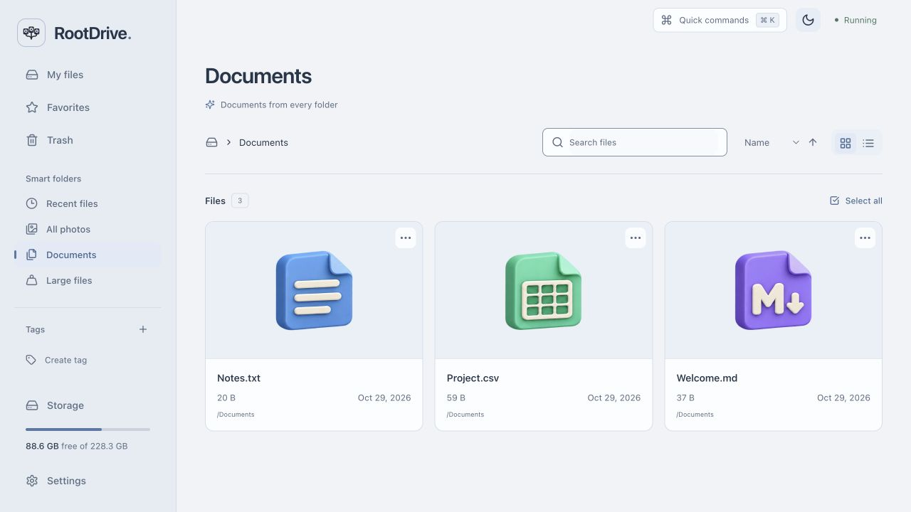
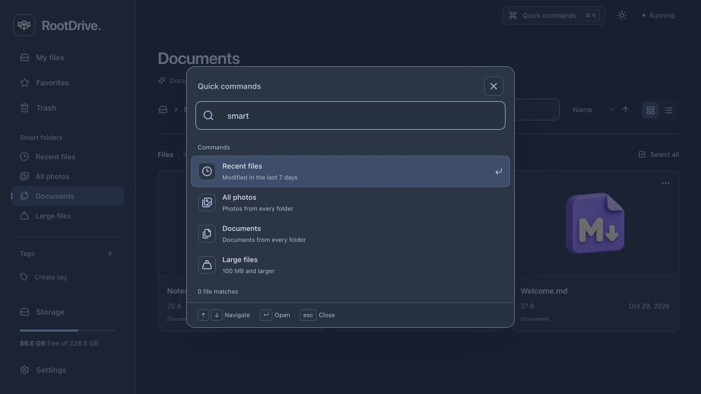
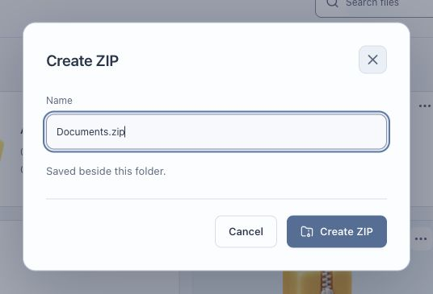

# Update 1.6: Selection size

The selection toolbar shows the combined size of selected files and folders. Nested selections avoid double-counting a selected folder’s contents; separate Trash copies are counted independently.

---

# Update 1.5: Sorting preferences

File sorting and direction survive browser reloads. Each smart folder remembers its own order; ordinary folders, Favorites and tags share the normal file preference. Invalid saved values fall back to supported defaults.

---

# Update 1.4: Open file location

**Open file location** in the file menu and quick commands opens the physical parent folder and selects the original item. The backend calculates its page directly, including targets beyond the first page. Works from search, Favorites, tags and smart folders.

---

# Update 1.3: HotKeys update

Use **F2** to rename one selected file or folder and **Delete** to open the Move to Trash confirmation. Shortcuts stay inactive while typing, in dialogs, during pending actions and in Trash; repeated key events do not repeat actions.

---

# Update 1.2: Smart folders && quick commands

October 29, 2026

- **Smart folders:** Recent files, All photos, Documents and Large files. Automatic views across every folder, with originals kept in place.
- **Quick commands:** Cmd+K / Ctrl+K, or the top-bar button. Find files, jump between views, create files/folders, upload and switch theme.
- **Keyboard and mobile:** arrow-key navigation, Enter, Escape and touch-friendly controls.
- **Lightweight:** bounded result caching, debounced search and cancellation of obsolete requests. No new dependencies or background polling.

Restart RootDrive after updating. Normal startup rebuilds the frontend when needed.

Validation: **224 backend tests**, **64 frontend tests**, and a successful TypeScript/Vite production build. Desktop and mobile layouts checked in the browser.

---

# Updates

## Update 1.1: Zip

October 27, 2026

- Documents, Photos, Videos and Audio are created once when a workspace starts. Existing files stay safe; renamed or deleted folders are not recreated on every restart.
- Right-click a folder and choose **Create ZIP**. Name the archive and save it beside the original folder.
- Nested files and empty folders are included. Conflicting names show an error instead of replacing a file.
- **Download ZIP** remains available for direct downloads.

Restart RootDrive after updating. Set `CREATE_DEFAULT_FOLDERS=false` in `.env` if you prefer an empty workspace.

Validation: 205 backend tests, 51 frontend tests and the TypeScript/Vite production build passed. The ZIP workflow was also checked in the browser using isolated demo files.
