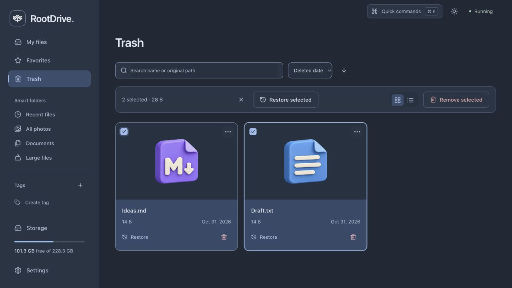

# Update 1.58: Private Spaces

Use a personal workspace or invite existing accounts to separate shared spaces with reader/editor access. Files, metadata, trash, previews and links stay isolated. Legacy shared storage remains available.

---

# Update 1.57: App Install

Install RootDrive as a standalone web app. The service worker caches only the static app shell and assets; API responses, shared pages and file contents are never stored offline.

---

# Update 1.56: Creative Workspace

Pin folders to the sidebar, preview Markdown beside code, format DOCX/ODT paragraphs and create audio playlists with continuous playback across navigation.

---

# Update 1.55: Photo Studio

Preview embedded JPEGs in supported RAW containers. Export JPEG, PNG or WebP copies, resize batches, remove EXIF/GPS and apply a text or uploaded-logo watermark with a preview.

---

# Update 1.54: Secure Sharing

Share folders with a public browser view and protect any link with a password. Expiring HttpOnly grants, rate limits and scoped paths protect access.

---

# Update 1.53: Smart Search

Find text inside notes, code and Office documents. Detect identical files using cached, streamed SHA-256 hashes; scans never delete originals.

---

# Update 1.52: Photo Gallery

Browse photos by date, use arrow keys or a slideshow, and organise virtual albums without moving the originals.

---

# Update 1.51: Archive Tools

Browse ZIP folders, download individual members and extract all or selected items into a new folder. Copy/cut/paste files and folders through the file menu and Ctrl/Cmd+C/X/V; drop files onto folder cards to move them. Copies never overwrite existing names. Unsafe ZIP paths, links, duplicate names and excessive expanded sizes are rejected. RootDrive now displays its numbered update and release name without the MVP label.

---

# Update 1.12: Server connection status

The header shows real connection state, offers retry after transport failures, and refreshes account/files after reconnection. Health checks run at most once per 45 idle seconds while visible and online; failed checks retry after five seconds and time out after eight. Hidden/offline pages and unmounted views stop checks. Normal successful API traffic resets the idle timer.

Validation: **240 backend tests**, **86 frontend tests**, a successful production build, and desktop/mobile browser checks including an actual server stop/restart.

---

# Update 1.11: Account password change

Signed-in users can change their own password in Settings after confirming the current password. Passwords use Argon2; the operation requires CSRF, is rate-limited, rotates the current cookie/security token and revokes other sessions. The form stays hidden when sign-in is disabled.

---

# Update 1.10: Trash search and sorting

Search Trash by filename or original path, sort by deletion date, original path or size, and paginate filtered results on the server. **Remove all** is disabled while a search is active so a filtered view cannot accidentally empty the whole Trash. Selected deletion and restoration remain available.

---

# Update 1.9: Bulk trash restoration

Select multiple Trash items and choose **Restore selected**. Parent folders restore before selected children. Conflicts, stale selections or database failures roll back the whole batch; existing files are never overwritten. Login and CSRF protection also apply to batch restoration.

---

# Update 1.8: Recent commands

Quick commands remembers the last five general command IDs in this browser, separately for each signed-in username or the shared workspace. No filenames, paths, search text or credentials are saved. File-specific actions are excluded; **Clear history** removes the list.

---

# Update 1.7: Smart folder filters

Choose 7, 30 or 90 days for Recent files, and 10 MB, 100 MB, 1 GB or 10 GB for Large files. Rules are enforced by the backend, cached separately and remembered by this browser.

---

# Update 1.6: Selection size

The selection toolbar shows the combined size of selected files and folders. Nested selections avoid double-counting a selected folder’s contents; separate Trash copies are counted independently.

---

# Update 1.5: Sorting preferences

File sorting and direction survive browser reloads. Each smart folder remembers its own order; ordinary folders, Favorites and tags share the normal file preference. Invalid saved values fall back to supported defaults.

---

# Update 1.4: Open file location

**Open file location** in the file menu and quick commands opens the physical parent folder and selects the original item. The backend calculates its page directly, including targets beyond the first page. Works from search, Favorites, tags and smart folders.

---

# Update 1.3: HotKeys update

Use **F2** to rename one selected file or folder and **Delete** to open the Move to Trash confirmation. Shortcuts stay inactive while typing, in dialogs, during pending actions and in Trash; repeated key events do not repeat actions.

---

# Update 1.2: Smart folders && quick commands

October 29, 2026

- **Smart folders:** Recent files, All photos, Documents and Large files. Automatic views across every folder, with originals kept in place.
- **Quick commands:** Cmd+K / Ctrl+K, or the top-bar button. Find files, jump between views, create files/folders, upload and switch theme.
- **Keyboard and mobile:** arrow-key navigation, Enter, Escape and touch-friendly controls.
- **Lightweight:** bounded result caching, debounced search and cancellation of obsolete requests. No new dependencies or background polling.

Restart RootDrive after updating. Normal startup rebuilds the frontend when needed.

Validation: **224 backend tests**, **64 frontend tests**, and a successful TypeScript/Vite production build. Desktop and mobile layouts checked in the browser.

---

# Updates

## Update 1.1: Zip

October 27, 2026

- Documents, Photos, Videos and Audio are created once when a workspace starts. Existing files stay safe; renamed or deleted folders are not recreated on every restart.
- Right-click a folder and choose **Create ZIP**. Name the archive and save it beside the original folder.
- Nested files and empty folders are included. Conflicting names show an error instead of replacing a file.
- **Download ZIP** remains available for direct downloads.

Restart RootDrive after updating. Set `CREATE_DEFAULT_FOLDERS=false` in `.env` if you prefer an empty workspace.

Validation: 205 backend tests, 51 frontend tests and the TypeScript/Vite production build passed. The ZIP workflow was also checked in the browser using isolated demo files.

The Update 1.3–1.12 series contains ten separate feature commits. Commit author/committer timestamps were explicitly assigned to the requested schedule; they are not a record of actual implementation times.
